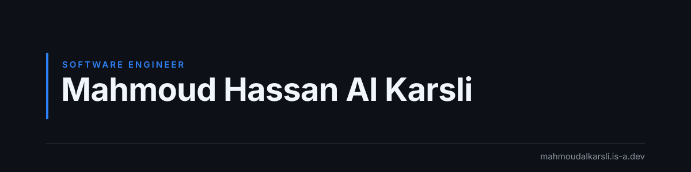
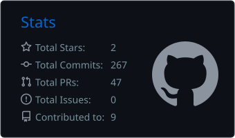
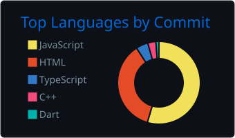
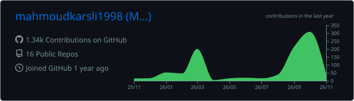

  

  
  
  

## About Me

Hi, I'm **Mahmoud Hassan Al Karsli** (محمود حسن الكرسلي), a software engineer who is half Egyptian 🇪🇬 and half Turkish 🇹🇷. I build mobile and full-stack applications, with a focus on clean architecture, performance, and user experience.

<table>
  <tr>
    <td valign="top" width="50%">

**🔭 Currently working on**
- Building innovative mobile applications
- Expanding my development portfolio
- Improving app performance and user experience

**🌱 Currently learning**
- Advanced testing methodologies
- Backend development
- System architecture & design patterns

</td>
    <td valign="top" width="50%">

**👯 Open to collaborate on**
- Mobile app projects (especially Flutter)
- Open-source mobile development tools
- Projects that solve real-world problems

**💬 Ask me about**
- Flutter & cross-platform development
- Mobile app architecture
- Java, OOP, problem solving & algorithms

</td>
  </tr>
</table>

> ⚡ **Fun fact:** I can debug code faster than I can debug my life decisions 😄

## Tech Stack

  
    
  
    
  

## GitHub Stats

  
  

  

  

## Contribution Graph

  <picture>
    <source media="(prefers-color-scheme: dark)" srcset="https://raw.githubusercontent.com/mahmoudkarsli1998/MahmoudKarsli1998/output/github-snake-dark.svg"/>
    <source media="(prefers-color-scheme: light)" srcset="https://raw.githubusercontent.com/mahmoudkarsli1998/MahmoudKarsli1998/output/github-snake.svg"/>
    
  </picture>

